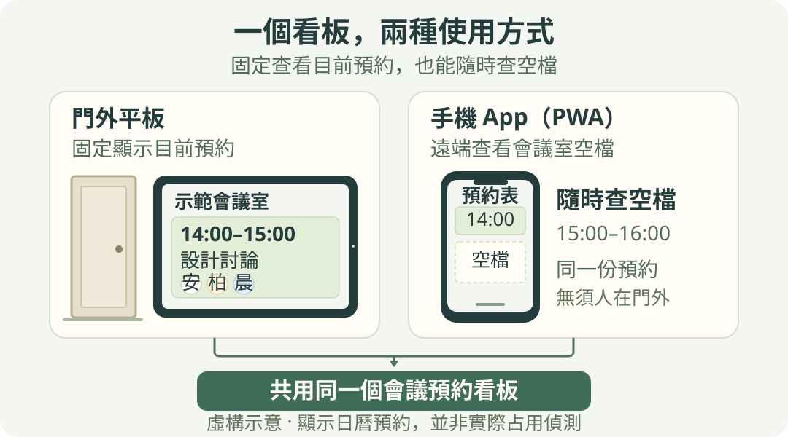

# Roomly 會議室看板

把平板放在會議室門外，讓經過的人查看目前與接下來的預約；其他成員也能在手機開啟同一個空間，先確認是否有空檔。Roomly 將多人 Google 日曆中符合會議室地點的活動，彙整成每格 30 分鐘的共用甘特圖。

**[開始使用免費公開版](https://demo.terry878.org/roomly/)** · **[GitHub Pages 介紹與入口](https://terry-eric.github.io/roomly/)** · **[支持與維護計畫](https://demo.terry878.org/roomly/support.html)**

公開版可使用真實 Google 帳號與日曆，各團隊自行建立獨立空間。GitHub Pages 是介紹頁，會連到上方完整服務；它本身不處理登入或會議資料。


## 團隊怎麼開始？

1. 使用自己的 Google 帳號登入，按「建立空間」，填入名稱與 Google 日曆邀請中的會議室地點。
2. 到「空間設定」授權自己的日曆，需同意活動唯讀與日曆清單唯讀兩項權限。
3. 管理員輸入成員的 Google Email，產生專用邀請連結，再自行將連結分享給對方。**不會自動寄 Email。**
4. 對方用指定 Google 帳號登入，同意在這個空間分享符合地點的會議，並自行授權日曆。
5. 按「同步會議」，取得所有空間成員的最新會議；展開「同步來源」可查看每個帳號是否授權、同步結果及最後成功時間。

邀請只能由指定 Google Email 接受，有效 7 天。空間管理員可撤銷尚未接受的邀請或移除成員；每個帳號最多建立 3 個空間，每個空間最多 10 位成員，包含待接受的邀請。這些是服務資源上限，並非付費功能。

建立與修改預約仍在 Google 日曆操作。請使用空間設定中的相同地點，然後回到 Roomly 按同步。管理員不能代替他人授權，也不能直接讀取他人的完整日曆。

## 公開版只在你按同步時更新

「同步會議」發出的 `POST /roomly/api/spaces/:id/sync` 是啟動 Google 日曆讀取的唯一入口。佇列只繼續處理這次明確要求的工作；單純登入、開啟看板、切換日期或查看來源狀態，只讀取後端已保存的資料。沒有定時補查、Google 變更通知或背景自動同步。

同步成功時間只在完整取得並保存來源資料後更新，送入佇列不算成功。尚未授權、資料缺少或同步失敗會分別標示；未知時段不會被當作會議室空閒。新增、修改或取消會議後，請再按同步。

**[公開版使用、授權及自架教學](docs/COMMUNITY.md)** 有完整說明。原本單團隊自架版的變更通知與定時補查仍保留在另一套部署模式，請見 [單團隊同步文件](docs/SHARED-CALENDAR.md)。

## 實際應用場景



- **會議室門外的平板**：開啟全螢幕，查看目前預約何時結束、下一場何時開始；需要時點會議或人物圓圈看詳細資料。
- **辦公桌或外出的手機**：打開相同空間，查看今天與接下來幾天的空檔；將網站加入主畫面，可用 App（PWA）方式開啟。

看板依日曆預約顯示使用狀況，不會感測現場是否有人；受邀者也不代表實際出席。空白只代表已成功同步的來源沒有相符預約，仍要留意來源授權與最後成功時間。

## 主要功能

- 台北時間 09:00–19:00、每格 30 分鐘的五日甘特圖。
- 今天高亮、目前時段置中、日期切換、跳過週末或台灣國定假日（內建 2026、2027 年）。
- 點人物圓圈看姓名，點會議看受邀者與 Google Meet 連結。
- 手機、平板與電腦排版，全螢幕及可安裝的 PWA。
- 多個獨立空間、本人日曆授權、指定 Email 邀請、成員與授權狀態管理。
- 手動同步所有空間成員可讀取日曆中符合地點的會議。

## Google 授權的目前限制

公開服務的 Google 專案目前為 **Production**，日曆敏感權限仍未完成 Google 驗證。2026 年 10 月 14 日檢查時，Console 顯示已使用 **7／100** 個授權名額；實際剩餘名額以 Google Console 為準。基本 Google 登入與日曆授權是不同步驟，後者可能顯示未驗證警示或受到 Workspace 管理政策限制。

這不是付費造成的限制，打賞也不會解除 Google 的授權上限。公開服務與公司服務的資料庫、登入及日曆憑證分開，但若使用同一個 Google Cloud 專案，Google 的專案授權上限仍共用。Production 不等於通過驗證，也不代表可以無限新增日曆授權帳號。[Google Audience 與 OAuth user cap 說明](https://support.google.com/cloud/answer/15549945?hl=en)

## 支持 Roomly

免費公開版以手動同步降低雲端用量。即時同步需要持續運作的通知、背景工作、資料庫與維護成本；若未來獲得支持，將評估開放更多功能，時間與內容會另行公告。

[支持頁](https://demo.terry878.org/roomly/support.html)目前只有維護計畫說明，**尚未準備收款連結，沒有付款、打賞收款或立即解鎖功能**。

## 選擇使用方式

| 方式 | 適合用途 | 真實會議資料 | 教學 |
| --- | --- | --- | --- |
| 免費公開服務 | 小團隊直接使用自己的 Google 帳號與日曆 | 空間成員共用，手動同步 | [公開版說明](docs/COMMUNITY.md#直接使用公開服務) |
| 自架多團隊版 | 用自己的 Google 專案與 Cloudflare 提供獨立空間 | 自己的 D1，手動同步 | [本機](docs/COMMUNITY.md#本機開發多團隊版)／[雲端](docs/COMMUNITY.md#部署多團隊版到-cloudflare) |
| 單團隊／公司自架版 | 一份白名單、一間會議室、背景更新 | 自己的 D1，自動與手動同步 | [另一模式的部署教學](docs/DEPLOYMENT.md#單團隊公司自架模式) |
| `npm run demo` | 純介面與觸控展示 | 全部虛構，不登入、不同步 | [操作截圖](docs/SCREENSHOTS.md) |
| GitHub Pages | 介紹產品並連到完整服務 | Pages 不處理資料 | [發布入口頁](docs/DEPLOYMENT.md#github-pages發布入口頁) |

## 本機快速開始

需要 Node.js 24 或更新版本與 npm，在專案資料夾執行：

```sh
git clone https://github.com/terry-eric/roomly.git
cd roomly
npm ci
```

只看獨立的虛構介面展示：

```sh
npm run demo
```

開啟 [http://127.0.0.1:4173](http://127.0.0.1:4173)。這不會讀取真實帳號或日曆。`npm run build:demo` 產生 `demo-dist/`，與 GitHub Pages 的 `pages-dist/` 分開。

要測試真實多團隊流程，先依 [多團隊本機教學](docs/COMMUNITY.md#本機開發多團隊版)設定自己的 OAuth 與 `.dev.vars`，再執行：

```sh
npm run dev:community
```

入口是 [http://localhost:3000/roomly/](http://localhost:3000/roomly/)。這會建置 `community-dist/`、套用 `migrations-community/` 並啟動本機 Worker；不會部署到雲端。


上圖與 [操作截圖](docs/SCREENSHOTS.md)來自 `npm run demo`，會議、人物和地點全部虛構；它們示範共用甘特圖操作，並非新公開版的空間管理畫面。

## 開發指令

| 指令 | 用途 |
| --- | --- |
| `npm ci` | 安裝鎖定的相依套件 |
| `npm run dev:community` | 建置與啟動多團隊本機服務 |
| `npm run db:community:local` | 套用多團隊本機 D1 migrations |
| `npm run db:community:remote` | 套用自己設定的多團隊雲端 D1 migrations |
| `npm run build:community` | 產生多團隊 `community-dist/roomly/` |
| `npm run check:community` | 建置並檢查本機設定的 Worker dry run，不部署 |
| `npm run deploy:community` | 建置並依自己的 `wrangler.community.jsonc` 部署 |
| `npm run build:pages` | 產生 GitHub Pages 入口頁 `pages-dist/` |
| `npm run demo`／`npm run build:demo` | 另行啟動／建置虛構展示 |
| `npm test`／`npm run typecheck` | 測試與 TypeScript 檢查 |
| `npm run dev`／`npm run deploy` | 舊單團隊模式，本機／雲端部署 |

公開多團隊版使用 `src/community/`、`PUBLIC_DB` 與 `PUBLIC_SYNC_QUEUE`；舊單團隊版使用 `src/worker.ts`、`DB` 與另一套 migrations。勿將兩種部署的資料庫、加密金鑰或授權資料混用。

`.dev.vars`、`wrangler.community.jsonc`、真實 Client Secret、加密金鑰、登入資料及資料庫匯出均不得加入 Git。Repository 只有一般設定範例，不提供可使用的私人帳號或密鑰。自架者需配置自己的 Google 專案、網域與隱私說明，發布程式碼不等於通過 Google 驗證。
