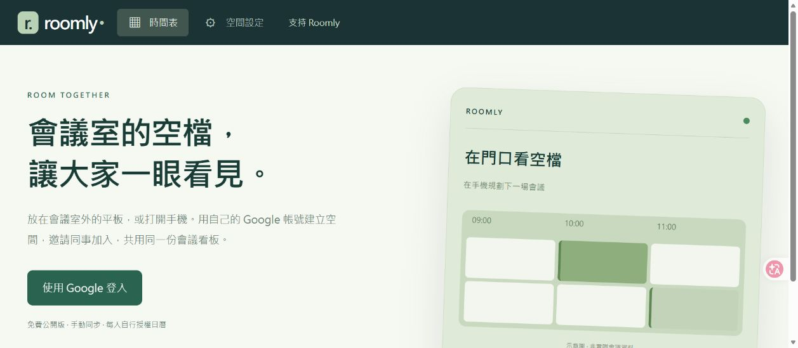
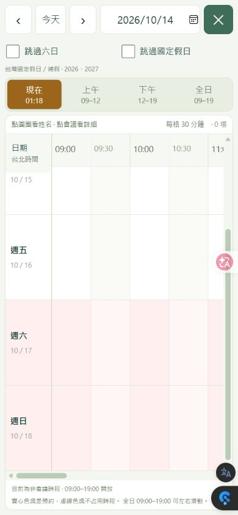
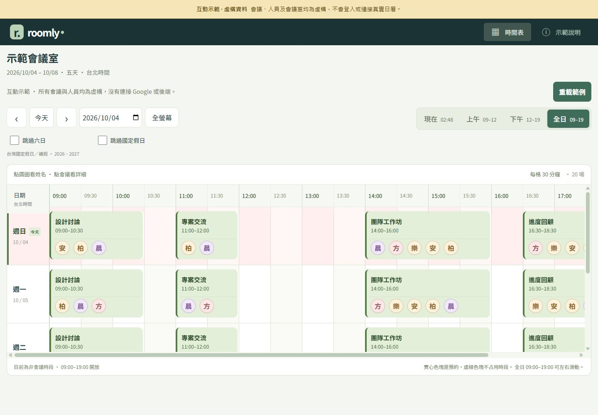
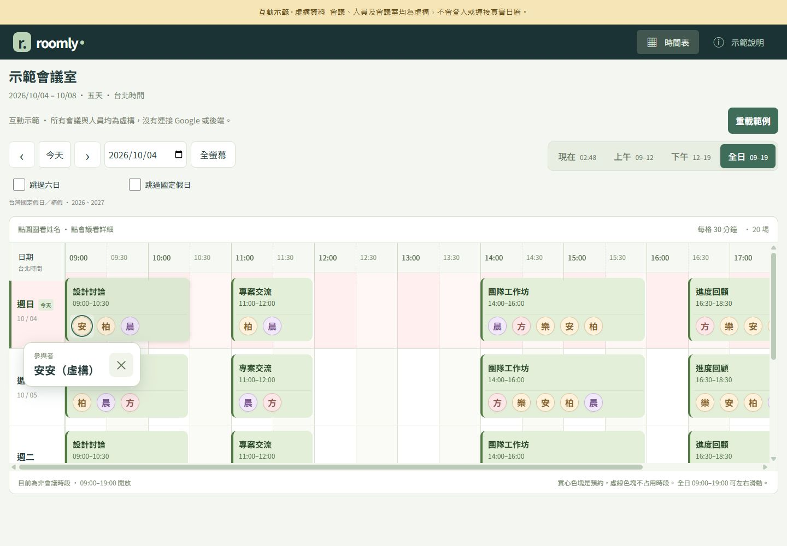
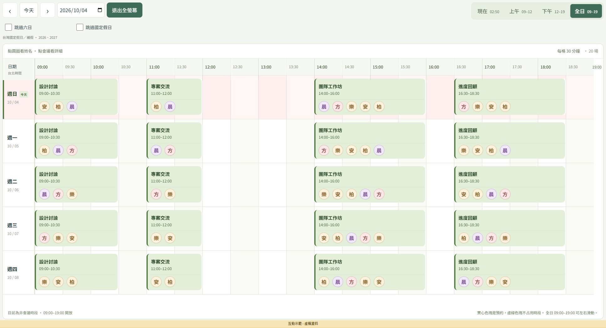
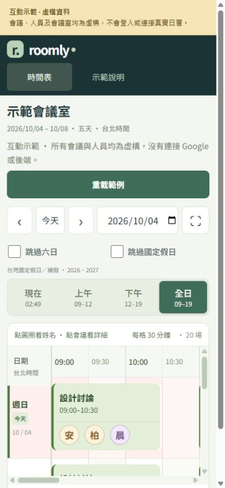

# 操作教學與截圖：公開入口與虛構介面示意

目前 [免費公開服務](https://demo.terry878.org/roomly/)使用真實 Google 登入，各團隊自行建立獨立空間、分享指定 Email 的邀請連結，再由每人自行授權日曆。按「同步會議」才讀取 Google；切換日期只看既有快取。GitHub Pages 現在是[介紹與入口頁](https://terry-eric.github.io/roomly/)，並非虛構會議展示。

以下是公開版在 390 像素手機寬度下的全螢幕實測畫面，已將甘特圖往下滑動。測試帳號已完成 5 個真實日曆的手動同步；測試地點沒有相符預約，因此顯示 0 場。畫面沒有私人 Email 或公司地點。

實際使用情境是把平板固定在會議室外，以空間成員帳號登入並開啟全螢幕看板，讓大家查看目前及接下來的預約。其他成員可在手機安裝公開服務的 PWA，用自己的帳號查看相同空間；預約仍在 Google 日曆建立或修改。登入、建立空間、邀請與授權的完整教學見 [COMMUNITY.md](COMMUNITY.md)。

看板依已授權 Google 日曆中符合會議室地點的活動顯示資料，不會感測現場是否有人，也不會記錄實際出席。空白時段只代表目前已授權來源沒有相符預約，不能保證實體會議室無人使用；最新資訊也受授權狀態、網路與同步時間影響。

下方甘特圖、人物、全螢幕及手機截圖取自獨立的 `npm run demo`，會議、人物和地點全部虛構，日期會依開啟當天產生。它們只示範共用的甘特圖操作，**不是新公開版的空間管理畫面，也不是現在的 GitHub Pages**。依 [README](../README.md)啟動本機虛構展示即可操作相同範例。

## 1. 查看預約

每一列是一個日期，每一格是三十分鐘。色塊表示預約，圓圈表示受邀者；空白表示範例中沒有預約。時間範圍為台北時間 09:00–19:00。

用日期旁的箭頭或日期欄切換開始日，按「今天」回到當天。可勾選「跳過六日」或「跳過國定假日」；國定假日資料內建 2026、2027 年。按「上午」、「下午」或「全日」切換查看的時段，按「現在」移到目前時段。

## 2. 點人物與會議

直接點預約上的人物圓圈，會出現完整姓名；按小視窗的叉號關閉。點會議色塊可查看時間與受邀者等詳細資料。正式版有 Meet 連結時，詳細資料才提供加入會議入口。

受邀者表示日曆邀請中的人員，不代表已實際出席。展示版不會連到真實會議，也不會預約或修改日曆。

## 3. 全螢幕預覽

按日期旁的「全螢幕」，畫面會集中顯示日期、時段切換與甘特圖。可在甘特圖內左右滑動查看時間、上下滑動查看日期；按「退出全螢幕」回到原畫面。桌面原生全螢幕也可按 `Esc` 離開。

瀏覽器不支援原生全螢幕時，會使用頁面內的滿版預覽；瀏覽器網址列是否隱藏仍由裝置及瀏覽器決定。

## 4. 手機與平板

小螢幕會讓日期、篩選及時段按鈕分行排列。甘特圖保留可點選的寬度，可在表格內橫向滑動。平板橫放可同時查看更多時段。

要用同一個 Wi-Fi 的手機看電腦上的虛構範例，可執行 `npm run demo -- --host 0.0.0.0`，並在手機開啟 `http://<電腦區域網路IP>:4173/`；作業系統需允許區域網路連線。公開服務的 PWA 已使用 HTTPS，可在支援的瀏覽器安裝或由 iPhone Safari「分享 → 加入主畫面」。GitHub Pages 入口頁本身不提供安裝或 Google 登入。

## 5. 虛構展示與公開服務分開

虛構展示中的「重載範例」只重新產生本機假資料，不能同步 Google 日曆。要讀取自己團隊的會議，直接使用 [免費公開服務](https://demo.terry878.org/roomly/)，或按 [多團隊部署教學](COMMUNITY.md)架在自己的 Cloudflare。公開版的「同步會議」是手動讀取真實日曆，不會自動更新。

要發布產品介紹與服務入口，請按 [GitHub Pages 發布教學](DEPLOYMENT.md#github-pages發布入口頁)操作。原本的單團隊／公司版仍另外保留 [白名單與自動同步說明](SHARED-CALENDAR.md)，勿將其同步規則套用到公開多團隊版。
